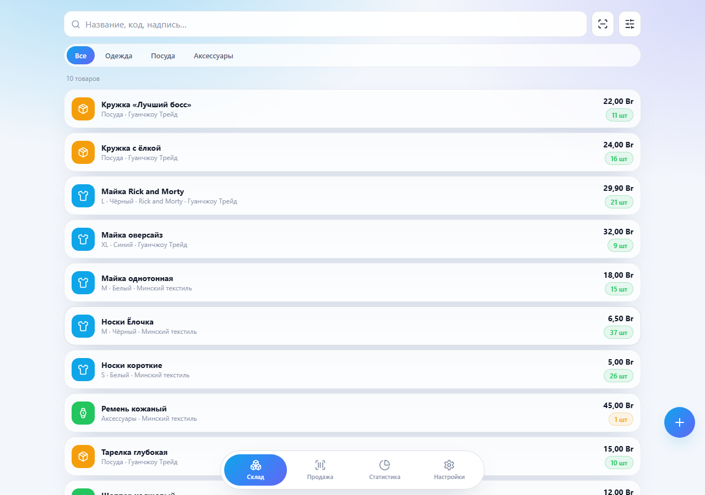
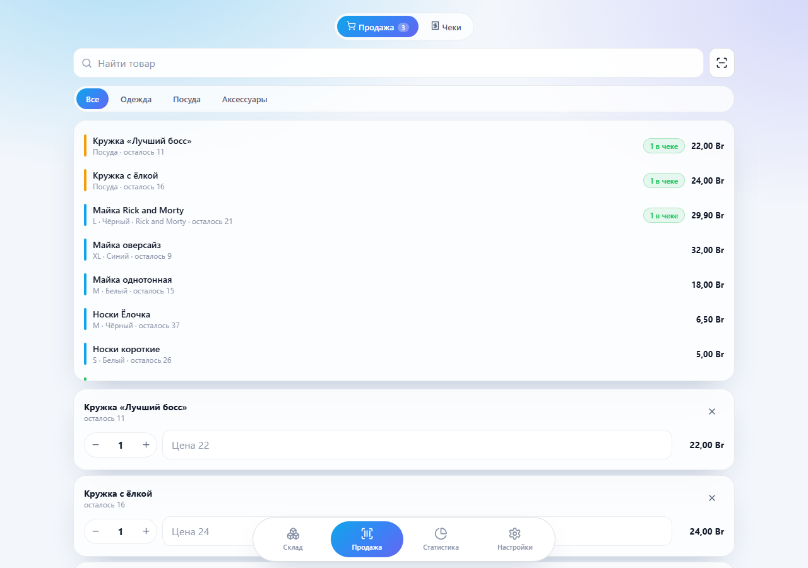
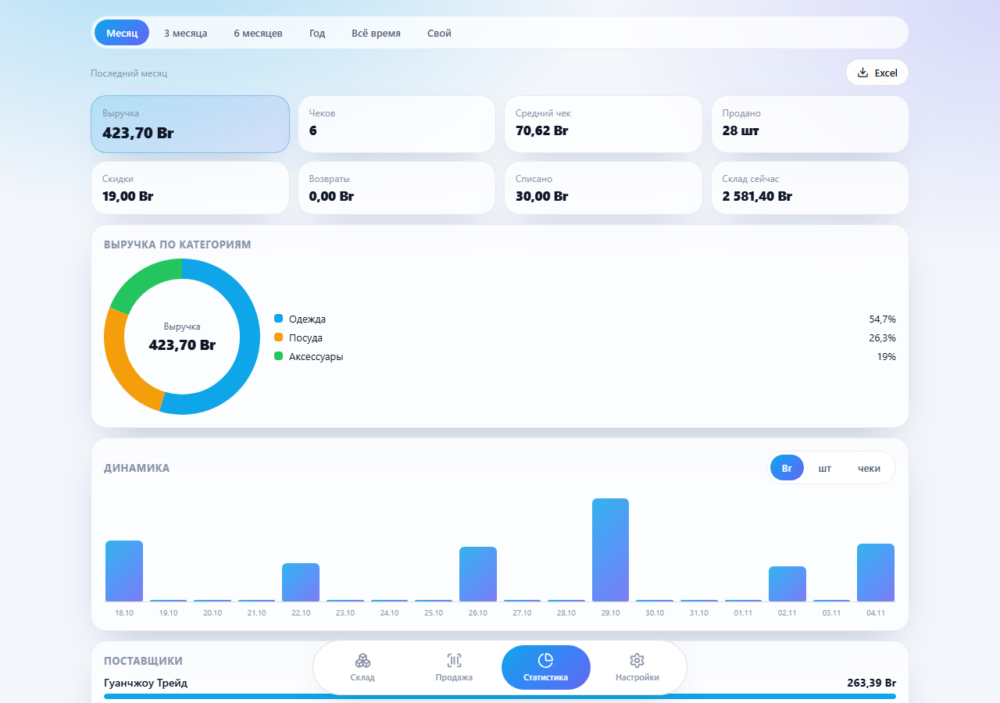
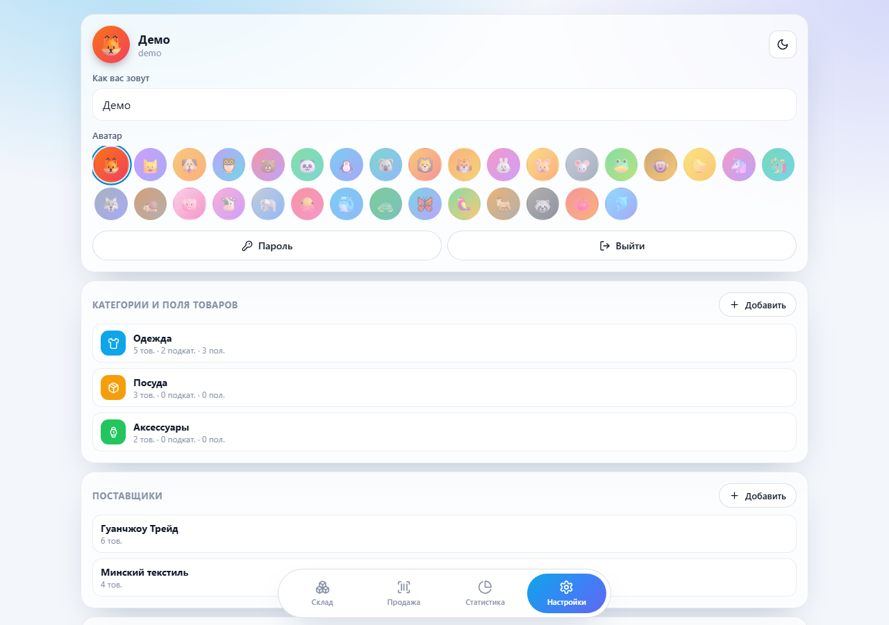
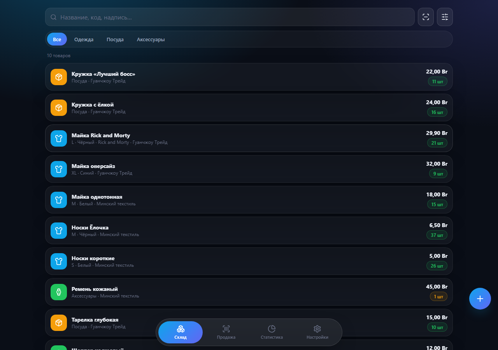
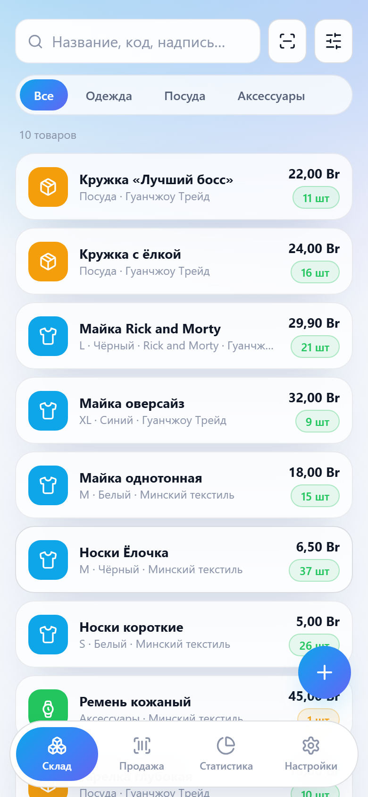

<div align="center">


# Store Manager · warehouse for a small shop

Self-hosted web app: products with per-category attributes, suppliers, multi-item
receipts, detailed stats with Excel export, and barcode scanning on iPhone.

[](https://github.com/KROWIEL/warehouse-manager/releases)
[](https://github.com/KROWIEL/warehouse-manager/actions/workflows/ci.yml)
[](LICENSE)

**[Project site](https://krowiel.github.io/warehouse-manager/)** ·
**[Quick start](#quick-start)** ·
**[Русский](README.md)**

</div>

## Why

Cloud CRMs are often overkill for a small shop and keep your data elsewhere.
Store Manager is a single Docker image on your server: catalog, stock, sales and
Excel reports — no subscription, no third-party cloud.

## Screenshots

<p align="center">
  
  
</p>
<p align="center">
  
  
</p>
<p align="center">
  
  
</p>

## Features

- Categories, subcategories, suppliers, and configurable product attributes
- Stock as a movement journal (receipt, sale, return, write-off, inventory adjust)
- Multi-item receipts with discount, payment method, customer, negotiated price
- Stats for rolling or custom periods, breakdowns, dead/low stock
- Excel export (15 sheets + charts) and one-click SQLite backup
- PWA + camera barcode scanner (iOS included)
- No registration: accounts from `.env`, forced strong password on first login

## Quick start

```bash
git clone https://github.com/KROWIEL/warehouse-manager.git
cd warehouse-manager
cp .env.example .env
docker compose -f docker-compose.local.yml up -d --build
```

Open **http://localhost:8080**. For HTTPS with a domain, fill `DOMAIN` /
`ACME_EMAIL` in `.env` and run `docker compose up -d --build` (Caddy included).

## License

[MIT](LICENSE)
