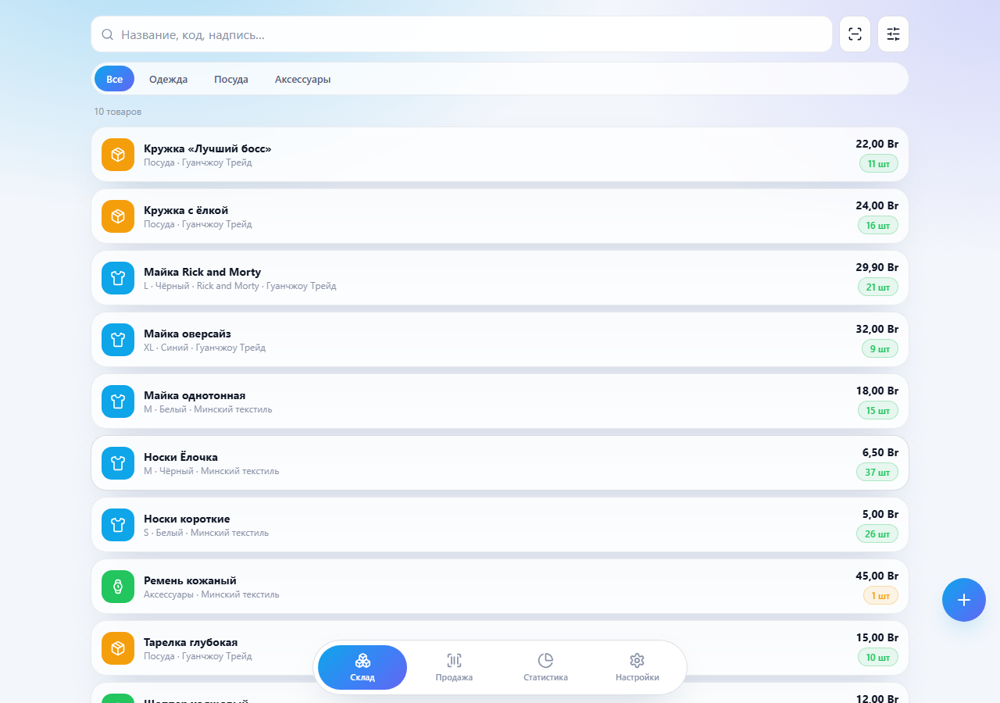
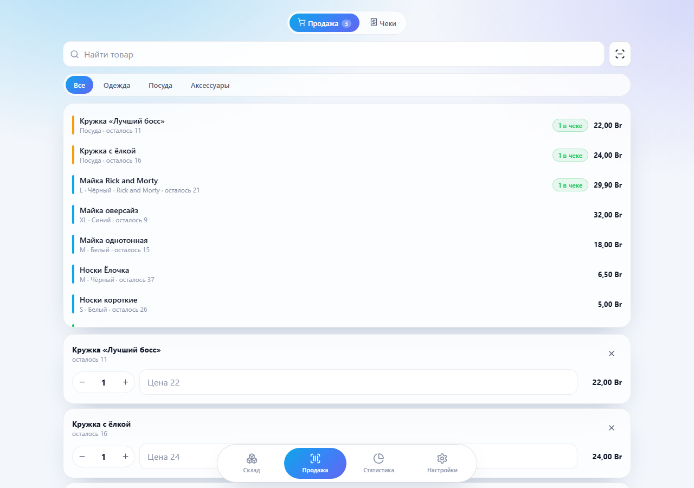
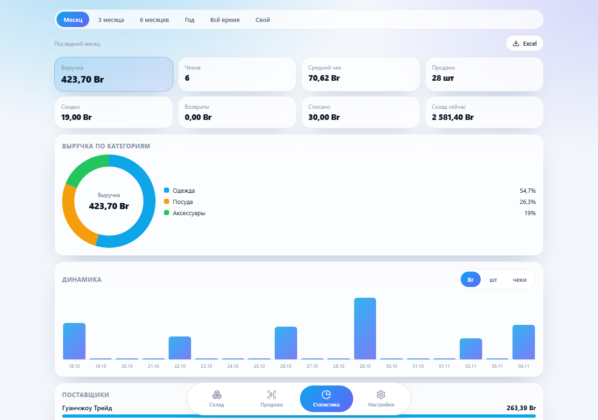
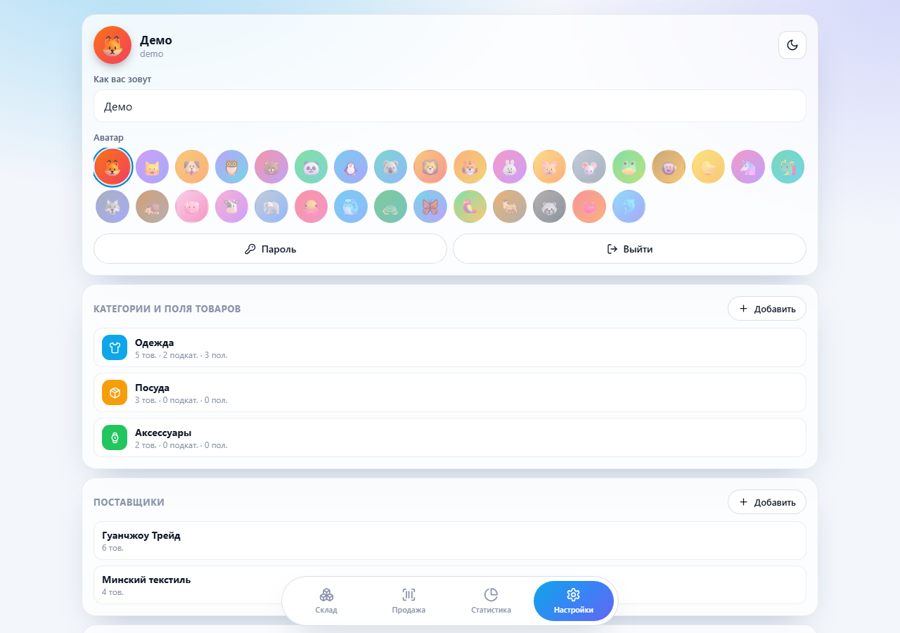
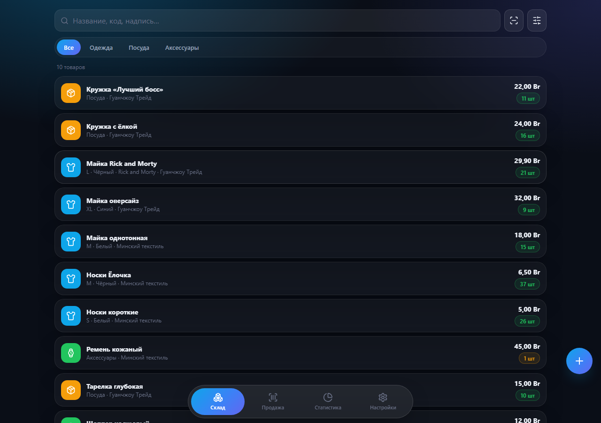
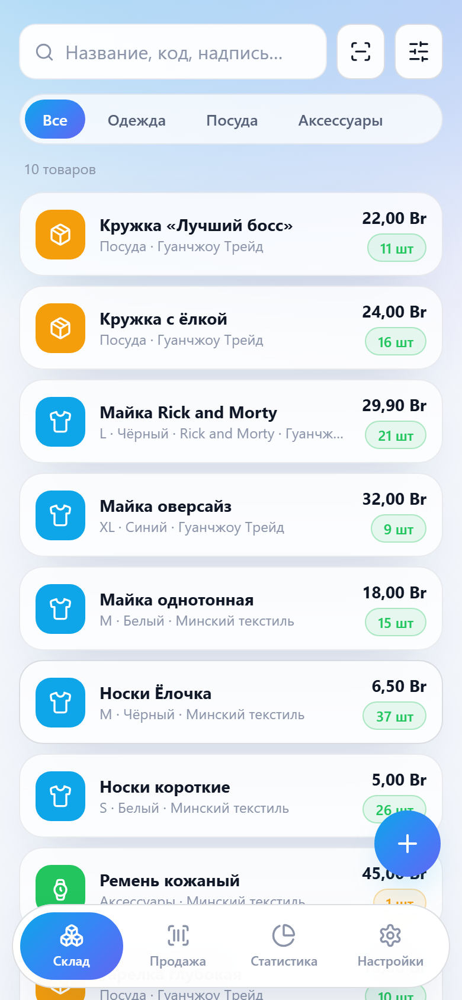

<div align="center">


# Store Manager · учёт склада для небольшого магазина

Self-hosted веб-приложение: товары с настраиваемыми полями, поставщики, продажи
чеками, подробная статистика с экспортом в Excel и сканер штрихкодов на iPhone.

[](https://github.com/KROWIEL/warehouse-manager/releases)
[](https://github.com/KROWIEL/warehouse-manager/actions/workflows/ci.yml)
[](LICENSE)


**[Сайт проекта](https://krowiel.github.io/warehouse-manager/)** ·
**[Быстрый старт](#быстрый-старт)** ·
**[English](README.en.md)**

</div>

## Зачем

Готовые облачные CRM и «складские» SaaS часто избыточны для небольшого магазина и
хранят данные у третьих лиц. Store Manager — один Docker-образ на вашем сервере:
каталог товаров, остатки, продажи и Excel-отчёт без подписки и без чужого облака.

## Скриншоты

<p align="center">
  
  
</p>
<p align="center">
  
  
</p>
<p align="center">
  
  
</p>

## Возможности

**Каталог и склад**
- Категории с цветом и иконкой, подкатегории внутри них.
- Настраиваемые поля товара под категорию: список вариантов или свободный текст
  (размер, цвет, надпись — или что угодно своё).
- Поставщик обязателен у каждого товара; по поставщикам строится статистика.
- Остаток считается из журнала движений: приход, продажа, возврат, списание,
  инвентаризация. История по каждому товару не теряется.

**Продажи**
- Чек с несколькими позициями, скидка на чек, способ оплаты, покупатель.
- Можно продать по договорной цене (торг) и вернуть товар на склад.
- Поиск по названию и полям, витрина с остатком, сканер штрихкодов камерой
  (включая iPhone).

**Статистика и отчёты**
- Скользящие периоды и свой диапазон дат: выручка, скидки, средний чек, возвраты.
- Разрезы по категориям, подкатегориям, поставщикам, товарам, продавцам, оплате
  и значениям любого настроенного поля; динамика по дням/неделям/месяцам.
- Низкие остатки и «мёртвый сток».
- Экспорт в `.xlsx` — 15 листов: каждая позиция с продажами и остатком, разрезы,
  первичка чеков и движений, живые графики Excel.
- Резервная копия базы одной кнопкой (`sqlite3.backup()`).

**Доступ**
- Регистрации нет: аккаунты задаются в `.env`, при первом входе — смена на строгий пароль.
- PWA: ставится на домашний экран телефона.

## Быстрый старт

Нужен Docker с плагином Compose.

```bash
git clone https://github.com/KROWIEL/warehouse-manager.git
cd warehouse-manager
cp .env.example .env        # задайте логины и пароли
docker compose -f docker-compose.local.yml up -d --build
```

Откройте **http://localhost:8080** и войдите под пользователем из `.env`.
Приложение сразу попросит сменить одноразовый пароль на строгий.

## Установка на сервер с доменом и HTTPS

В комплекте есть [Caddy](https://caddyserver.com/): он сам получит и будет продлевать
сертификат Let's Encrypt.

1. Направьте A-запись домена (например, `store.example.com`) на IP сервера.
   Порты **80** и **443** должны быть открыты.
2. Заполните `.env`:

   ```bash
   cp .env.example .env
   nano .env
   ```

   | Переменная | Что указать |
   | --- | --- |
   | `DOMAIN` | ваш домен без `https://` |
   | `ACME_EMAIL` | email для Let's Encrypt |
   | `COOKIE_SECURE` | `true` — сайт работает только по HTTPS |
   | `SEED_USER{N}_*` | логин, имя, пароль и аватар каждого продавца |

3. Запустите:

   ```bash
   docker compose up -d --build
   ```

Приложение откроется на **https://ваш-домен**. Порт 8080 наружу не публикуется —
весь трафик идёт через Caddy. База SQLite лежит в `./data` на хосте.

Обновление: `git pull && docker compose up -d --build`.

Сканер штрихкодов проверяйте уже по HTTPS: с телефона по `http://192.168.x.x`
камера не включится — это ограничение браузера.

## Конфигурация

| Переменная | По умолчанию | Назначение |
| --- | --- | --- |
| `SEED_USER{N}_USERNAME` | — | логин (без него пользователь не создаётся) |
| `SEED_USER{N}_PASSWORD` | — | одноразовый пароль при первом запуске |
| `SEED_USER{N}_NAME` | логин | отображаемое имя |
| `SEED_USER{N}_AVATAR` | `fox` | эмодзи-аватар из списка |
| `COOKIE_SECURE` | `false` | Secure-cookie; включите за HTTPS |
| `SESSION_DAYS` | `30` | сколько дней живёт сессия |
| `DEAD_STOCK_DAYS` | `60` | порог «мёртвого стока» |
| `DOMAIN`, `ACME_EMAIL` | — | только для Caddy |

Пользователи создаются один раз. Дальше имя, аватар и пароль меняются в настройках.

## Резервные копии

В настройках есть кнопка **«Скачать копию базы»** — консистентный снимок через
`sqlite3.backup()`. Можно просто скопировать каталог `data/`.

## Разработка

```bash
# Backend (Python 3.12+)
cd backend
pip install -r requirements.txt
DATA_DIR=./data COOKIE_SECURE=false \
  SEED_USER1_USERNAME=ivan SEED_USER1_PASSWORD=dev-pass \
  uvicorn app.main:app --reload --port 8080

# Frontend — dev-сервер с прокси /api на :8080
cd frontend
npm install
npm run dev
```

Проверка логики без фреймворков:

```bash
cd backend
python selfcheck.py
```

Документация API (Swagger) — `/docs` у запущенного приложения.

### Как устроено

```
backend/        FastAPI + стандартный sqlite3, без ORM
  app/routers/  auth, catalog, products, sales, stats, profile, system
  app/export_xlsx.py   подробный Excel-отчёт с графиками
frontend/       Svelte 4 + Vite, SVG-графики, Lucide, PWA, сканер штрихкодов
caddy/          обратный прокси с автоматическим HTTPS
Dockerfile      сборка фронтенда и рантайм в одном образе
```

Остаток товара — `SUM(stock_movements.qty)`. Возврат ссылается на позицию чека,
поэтому выручка уменьшается с учётом скидки исходной продажи.

## Безопасность

- Пароли хешируются через PBKDF2-SHA256 с солью.
- При первом входе обязательна смена на строгий пароль; до этого API закрыт.
- Сессии — случайные токены в базе, cookie `HttpOnly` + `SameSite=Lax`.
- Регистрации нет: войти могут только пользователи из `.env`.

Нашли уязвимость — напишите через
[приватное сообщение об уязвимости](https://github.com/KROWIEL/warehouse-manager/security/advisories/new),
а не в публичный issue.

## Лицензия

[MIT](LICENSE) — используйте, копируйте, меняйте и распространяйте свободно, в том
числе в коммерческих проектах. Достаточно сохранить текст лицензии.
